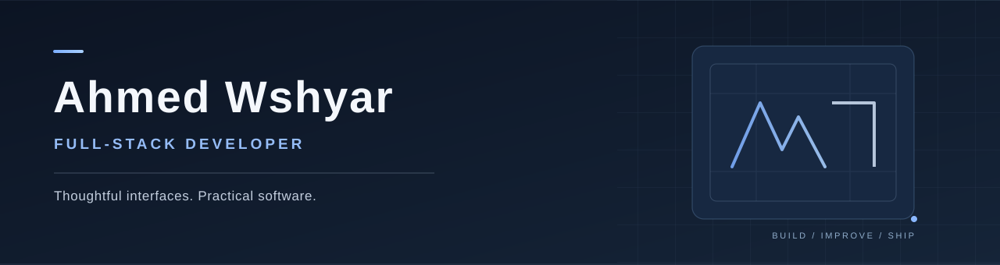

  

I’m **Ahmed Wshyar**, a full-stack developer who enjoys turning ideas into clear, useful, well-crafted digital products.

I work on websites, web applications, business tools, and the systems behind them. My focus is straightforward: **thoughtful design, dependable functionality, and software people enjoy using.**

## Selected work

### Real Estate Website · Independent Demo

A responsive real-estate website concept built around strong property presentation, clean navigation, and right-to-left layout support.

**Focus:** Responsive interfaces · UI/UX · RTL support · Web development

**Live demo:** `ADD_LIVE_DEMO_URL` &nbsp; | &nbsp; **Source code:** `ADD_PUBLIC_REPO_URL`

<!-- Replace the two project link placeholders above with verified public URLs. Do not link to private code. -->

*More selected projects will be featured here as they are ready to share.*

## What I build

- **Modern websites and web apps** — responsive interfaces with attention to detail.
- **Business software** — dashboards, workflows, and useful internal tools.
- **Backend services** — APIs, integrations, and application logic.
- **Product improvements** — usability, accessibility, performance, and maintainability.

## Tools I work with

| | |
| :-- | :-- |
| **Frontend** | React · TypeScript · JavaScript · Tailwind CSS |
| **Backend** | Node.js · Express · REST APIs |
| **Data** | PostgreSQL · MongoDB · Firebase · Prisma |
| **Workflow** | Git · GitHub · Vite · Playwright |

## How I approach my work

I care about more than getting a feature to run. I aim for interfaces that feel considered, code that is understandable, and solutions that fit the actual problem — without unnecessary complexity.

## Let’s build something useful

I’m open to **freelance web development, business software projects, and collaborations**.

[GitHub](https://github.com/arez-mohsin) · [Facebook](https://www.facebook.com/ahmed.wshyar.2025/)

**Portfolio:** `ADD_PORTFOLIO_URL` &nbsp; | &nbsp; **Email:** `ADD_PROFESSIONAL_EMAIL`

<!-- Add your real portfolio URL and professional public contact email when available. -->

---

Ahmed Wshyar · Full-Stack Developer
